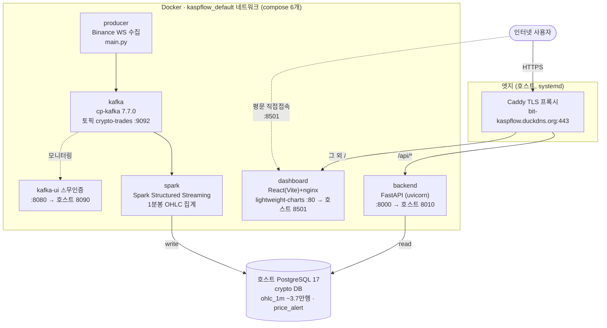
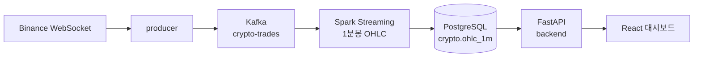

# kaspflow 아키텍처

> oracle_vm 실측 기준 · 스냅샷 2026-10-04, SSH 재확인 2026-10-05 (컨테이너 6개 정상 가동)
> 서버: `ssh oracle_vm` (`ubuntu@161.33.134.252`, OCI 도쿄 A1.Flex ARM64)

## 시스템 구성도

## 데이터 플로우

## 컨테이너 목록 (6개)

| 컨테이너 | 이미지 | 역할 | 포트 매핑 |
|---|---|---|---|
| `producer` | ghcr.io/jacob-9909/kaspflow-producer | Binance WebSocket → Kafka 적재 | 내부 전용 |
| `kafka` | confluentinc/cp-kafka:7.7.0 | 메시지 브로커 (토픽 `crypto-trades`) | 9092 (외부 차단) |
| `spark` | ghcr.io/jacob-9909/kaspflow-spark | Structured Streaming, 1분봉 OHLC 집계 | 내부 전용 |
| `backend` | ghcr.io/jacob-9909/kaspflow-backend | FastAPI, `/api/*`·`/health` | 8010 → 8000 |
| `dashboard` | ghcr.io/jacob-9909/kaspflow-dashboard | React(Vite) + nginx 차트 UI | 8501 → 80 |
| `kafka-ui` | provectuslabs/kafka-ui | Kafka 모니터링 (무인증 ⚠) | 8090 → 8080 |

## 핵심 포인트

- **실행 방식**: Docker Compose `docker-compose.prod.yml`, 이미지는 GHCR에서 pull.
- **외부 노출**: Caddy가 `bit-kaspflow.duckdns.org`에서 TLS 종단 → `/api/*`는 8010(backend), 나머지는 8501(dashboard)로 분기.
- **DB**: 컨테이너가 아닌 **호스트의 PostgreSQL 17** `crypto` DB 사용 (`ohlc_1m`, `price_alert`).
- **배포**: 자동 CD — `kaspflow-autodeploy.timer`가 ~2분마다 GitHub `main` 폴링 → `git pull` → `compose pull/up -d` → `/health` 실패 시 롤백.
- **레포**: https://github.com/Jacob-9909/kaspflow (서버 HEAD `24f63bd`, `main`)

## 주의할 점

- ⚠️ `8501` 대시보드가 평문(HTTP)으로도 외부 직접 노출됨.
- ⚠️ `kafka-ui`(8090)는 외부 차단이지만 무인증.
- 🚨 `crypto` DB 포함 PostgreSQL **백업 없음** (oracle_vm 할 일 1순위).
