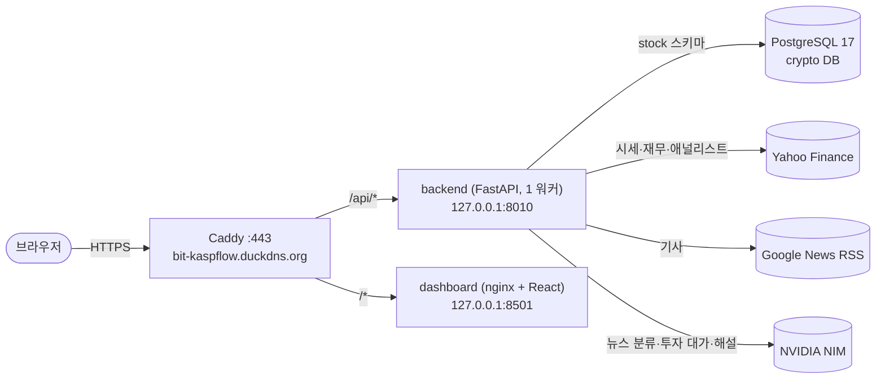
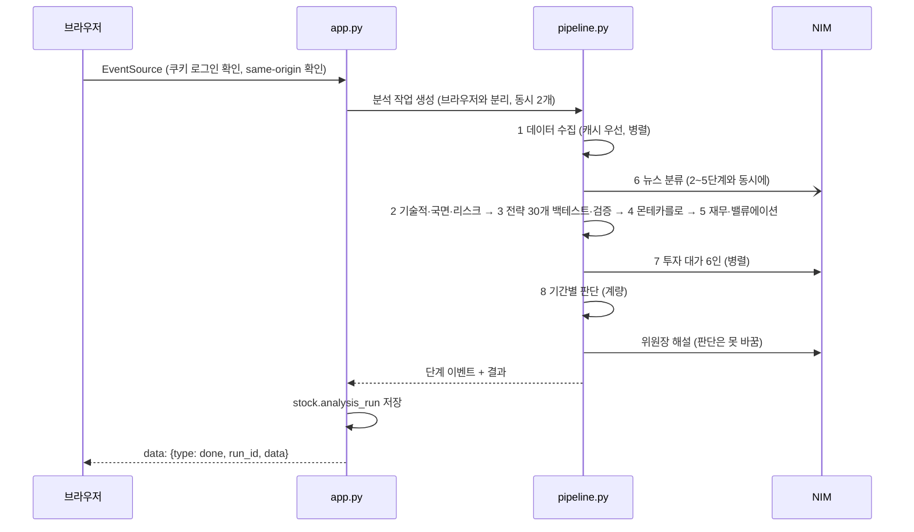

# kaspflow 아키텍처 (2세대: 주식 매매 검증기)

> 2026-11-16 재설계. 1세대(Binance → Kafka → Spark 1분봉 → 대시보드)는 git 기록에 남아 있다.
> 서버: `ssh oracle_vm` (OCI 도쿄 A1.Flex ARM64 2 OCPU · 12GB). 방법론은 [methodology.md](methodology.md).

## 시스템 구성

컨테이너는 backend, dashboard 2개다 (1세대는 6개). Kafka·Spark·Laya 모델을 내려 VM 메모리가 약 5GB 비었다.
컨테이너 런타임은 2026-11-16 부터 Docker Engine 대신 [kiri](https://github.com/libracoder/kiri) 다 (docker CLI·compose 는 그대로,
VM 설정은 [../infra/vm-setup.md](../infra/vm-setup.md) §K). 로컬 맥도 Docker Desktop 대신 kiri 를 쓴다.

## 한 번의 실행 (`GET /api/analyze/{symbol}`, SSE)

브라우저를 닫아도 작업은 끝까지 돌고 기록에 저장된다. LLM 단계는 시간 제한(뉴스 100초, 투자 대가 110초, 해설 80초)을
넘기거나 실패하면 규칙 점수·기본 문장으로 대신한다.

## 백엔드 모듈 (`backend/`)

| 파일 | 역할 |
|---|---|
| `app.py` | FastAPI 라우트, 비밀번호 로그인(HMAC 쿠키), SSE, 기록·적중률 |
| `pipeline.py` | 8단계 오케스트레이션, 결과 조립 |
| `market.py` | yfinance·구글 뉴스 수집, 캐시, 검색 |
| `indicators.py` / `strategies.py` | 지표(Wilder RSI, ATR, ADX 등), 전략 11개 |
| `backtest.py` / `validation.py` | 다음 날 시가 체결 벡터 엔진, 워크포워드·순열 검정·DSR·재표본 |
| `simulation.py` | 몬테카를로, 매매 계획, 유사 국면, 리스크 |
| `fundamentals.py` | 품질(피오트로스키, 알트만), DCF·역DCF·PEG·그레이엄·EPV, 컨센서스 |
| `news.py` / `personas.py` | NIM 뉴스 분류·집계, 투자 대가 체크리스트 + 의견 |
| `verdict.py` | 기술적·국면 점수, 기간별 가중 합산, 지금 할 일 조언(규칙, 다른 기간 판단 반영), 위원장 해설 |
| `llm.py` | NIM 클라이언트 (키 교대, 분당 제한, 재시도, 대체 모델, 캐시) |
| `db.py` / `schema.sql` | psycopg 풀, `stock.cache`, `stock.analysis_run` |

## 데이터베이스 (`crypto` DB, `stock` 스키마)

- `stock.cache(key, payload jsonb, fetched_at)`: 외부 데이터와 LLM 응답 캐시. 30일 지난 행은 기동 시 삭제.
- `stock.analysis_run(id uuid, symbol, horizon, verdict, score, confidence, price, result jsonb, ...)`: 실행 기록.
  `result` 에 화면을 다시 그릴 수 있는 전체 결과(약 300KB)가 있다. 공유 주소 `/?run=<id>` 가 이걸 읽는다.

## 배포

- CI: `ci-backend.yml` (유닛 + postgres:17 통합 테스트 + 이미지 import 검사), `ci-frontend.yml` (타입 검사 + 빌드).
- CD: `publish-images.yml` (테스트 → amd64/arm64 이미지 → GHCR) + VM 의 `kaspflow-autodeploy.timer` (2분 폴링,
  CI 게이트, 커밋별 이미지 태그, `/health` 실패 시 롤백). 자세한 절차는 [../infra/vm-setup.md](../infra/vm-setup.md).
- 비밀값은 VM 의 `~/kaspflow/.env` 에만 있다: `POSTGRES_PASSWORD`, `NVIDIA_API_KEY(_2)`, `APP_PASSWORD`, `SESSION_SECRET`(쿠키 서명 키).
