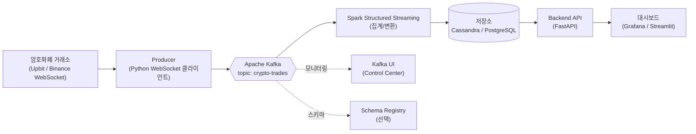
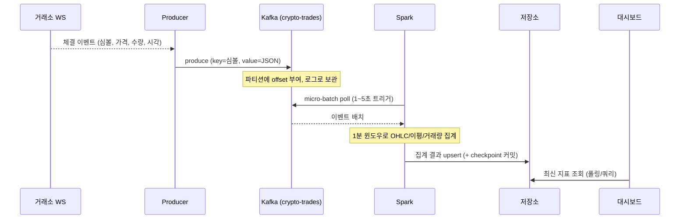

# 실시간 암호화폐 시세 대시보드 — 설계서

> Kafka + Spark Structured Streaming 기반의 실시간 데이터 파이프라인 사이드 프로젝트.
> 거래소 WebSocket에서 체결(trade) 스트림을 받아 실시간 지표를 집계하고 대시보드로 시각화한다.

- **문서 버전**: v0.1
- **작성일**: 2026-09-25
- **상태**: Draft (설계 단계)

---

## 1. 프로젝트 개요

### 1.1 목표
- 암호화폐 거래소의 **실시간 체결 데이터**를 수집·처리·저장·시각화하는 엔드투엔드 스트리밍 파이프라인을 구축한다.
- Kafka(메시지 브로커)와 Spark Structured Streaming(스트림 처리)의 **생산자–소비자 관계**를 실제로 체득하는 것을 학습 목표로 한다.
- 전체 스택을 `docker compose`로 한 번에 띄울 수 있게 한다.

### 1.2 왜 암호화폐인가
- 거래소가 **무료 WebSocket 스트림**을 제공해 초 단위로 데이터가 끊임없이 발생 → 스트리밍 실습에 최적.
- 인증/결제 없이 바로 붙을 수 있음 (Upbit, Binance 등).
- 이동평균, 거래량 급증, 변동성 같은 **의미 있는 실시간 지표**를 계산할 수 있음.

### 1.3 범위 (Scope)
| 구분 | 포함 | 제외 |
| --- | --- | --- |
| MVP | 시세 수집 → Kafka → Spark 집계 → 저장 → 대시보드 | 실거래/주문 실행 |
| 지표 | 실시간 가격, 1분 OHLC, 이동평균, 거래량 급증 탐지 | 예측/ML 모델 (후속) |
| 인프라 | 단일 노드 docker-compose | 멀티노드 클러스터, K8s (후속) |

---

## 2. 아키텍처

### 2.1 전체 구성도



### 2.2 컴포넌트별 역할
| 컴포넌트 | 역할 | 기술 |
| --- | --- | --- |
| **Producer** | 거래소 WebSocket 구독 → Kafka로 produce | Python (`websockets`, `confluent-kafka`) |
| **Kafka** | 체결 이벤트 버퍼링/전송 | Apache Kafka (KRaft 모드, Zookeeper 불필요) |
| **Schema Registry** | 메시지 스키마(Avro/JSON) 관리 (선택) | Confluent Schema Registry |
| **Spark** | micro-batch로 실시간 집계 | Spark Structured Streaming (PySpark) |
| **저장소** | 집계 결과 적재 | Cassandra (원안) 또는 PostgreSQL (경량 대안) |
| **Backend API** | 저장소 조회 → 대시보드에 데이터 제공 | FastAPI |
| **대시보드** | 실시간 시각화 | Grafana 또는 Streamlit |
| **Kafka UI** | 토픽/파티션/컨슈머 모니터링 | `provectuslabs/kafka-ui` |

> **원본 아키텍처(Airflow 포함) 대비 차이점**
> - 이미지에서는 Airflow가 API를 폴링했지만, 암호화폐는 **WebSocket 상시 연결**이 자연스러우므로 Producer를 상주 프로세스로 둔다.
> - Airflow는 이 프로젝트에선 **선택**: "일 단위 집계 배치", "오래된 데이터 정리(TTL)", "리포트 생성" 같은 스케줄 작업이 생기면 그때 추가한다.

### 2.3 데이터 흐름 (시퀀스)



---

## 3. 데이터 모델

### 3.1 원본 이벤트 (Kafka `crypto-trades` 토픽)
```json
{
  "symbol": "KRW-BTC",
  "price": 95321000.0,
  "volume": 0.0123,
  "side": "BID",
  "trade_ts": "2026-09-25T07:44:00.123Z",
  "source": "upbit"
}
```
- **Key**: `symbol` (같은 심볼은 같은 파티션 → 순서 보장)
- **파티션 수**: 3 (심볼 수/처리량에 따라 조정)

### 3.2 집계 결과 스키마

**`ohlc_1m` (1분봉)**
| 컬럼 | 타입 | 설명 |
| --- | --- | --- |
| symbol | text | 심볼 (PK) |
| window_start | timestamp | 윈도우 시작 (PK, clustering) |
| open / high / low / close | double | 시가/고가/저가/종가 |
| volume | double | 1분 거래량 |
| trade_count | int | 체결 건수 |

**`price_alert` (거래량/변동 급증 이벤트)**
| 컬럼 | 타입 | 설명 |
| --- | --- | --- |
| symbol | text | 심볼 |
| ts | timestamp | 탐지 시각 |
| alert_type | text | `VOLUME_SPIKE` / `PRICE_JUMP` |
| detail | text | 임계치 대비 배수 등 |

---

## 4. 처리 로직 (Spark)

### 4.1 집계 예시 (의사코드)
```python
from pyspark.sql import SparkSession
from pyspark.sql.functions import from_json, col, window, first, last, max, min, sum, count

spark = SparkSession.builder.appName("crypto-stream").getOrCreate()

# 1) Kafka 소스 구독
raw = (spark.readStream
       .format("kafka")
       .option("kafka.bootstrap.servers", "kafka:9092")
       .option("subscribe", "crypto-trades")
       .option("startingOffsets", "latest")
       .load())

# 2) JSON 파싱
trades = raw.select(from_json(col("value").cast("string"), TRADE_SCHEMA).alias("t")).select("t.*")

# 3) 1분 윈도우 OHLC 집계 (워터마크로 늦은 데이터 처리)
ohlc = (trades
        .withWatermark("trade_ts", "2 minutes")
        .groupBy(window(col("trade_ts"), "1 minute"), col("symbol"))
        .agg(
            first("price").alias("open"),
            max("price").alias("high"),
            min("price").alias("low"),
            last("price").alias("close"),
            sum("volume").alias("volume"),
            count("*").alias("trade_count"),
        ))

# 4) 저장소 sink + checkpoint
query = (ohlc.writeStream
         .outputMode("update")
         .option("checkpointLocation", "/chk/ohlc_1m")
         .foreachBatch(write_to_store)   # Cassandra/PostgreSQL upsert
         .trigger(processingTime="5 seconds")
         .start())

query.awaitTermination()
```

### 4.2 핵심 스트리밍 개념 (학습 포인트)
- **Watermark**: 늦게 도착한 이벤트를 어디까지 받아줄지 결정 (`2 minutes`).
- **Window**: 텀블링(1분) 윈도우로 OHLC 집계. 슬라이딩 윈도우로 이동평균 확장 가능.
- **Output Mode**: 집계는 `update`, 원본 저장은 `append`.
- **Checkpoint**: 장애 시 마지막 offset부터 재시작 → 정확성 보장.

---

## 5. 기술 스택 & 버전 (2026 기준)

| 영역 | 선택 | 비고 |
| --- | --- | --- |
| 메시지 브로커 | Apache Kafka 4.x (KRaft) 또는 3.9 LTS | Zookeeper 불필요 |
| 스트림 처리 | Spark 4.1 또는 3.5 LTS + `spark-sql-kafka` 커넥터 | Kafka 버전과 커넥터 호환 확인 |
| 저장소 | Cassandra 5.x (원안) / PostgreSQL 16 (경량 대안) | 처음엔 PostgreSQL 추천 |
| Producer | Python 3.12 + `websockets` + `confluent-kafka` | |
| Backend | FastAPI | |
| 대시보드 | Grafana (원안) / Streamlit (빠른 프로토타입) | |
| 컨테이너 | Docker + docker compose | |

> **버전 호환성 주의**: Spark ↔ Kafka 커넥터 버전이 어긋나면 스트리밍이 안 붙는다. Spark 3.5 LTS + Kafka 3.9 LTS 조합이 가장 안정적. (참고: [Kafka to Spark Integration Guide](https://markaicode.com/integrate/kafka-with-apache-spark/) — 내용은 요약, 라이선스 준수를 위해 재구성함)

---

## 6. 저장소 선택 가이드

| 기준 | Cassandra | PostgreSQL |
| --- | --- | --- |
| 원본 아키텍처 일치 | ✅ | △ |
| 시계열 쓰기 처리량 | ✅ 높음 | 보통 |
| 초기 학습 난이도 | 높음 (파티션 키 설계 필요) | 낮음 |
| 대시보드 연동 | Grafana 플러그인 | Grafana 기본 지원 |

> **추천 순서**: 1차 MVP는 **PostgreSQL**로 빠르게 완성 → 파이프라인이 돌면 **Cassandra**로 교체하며 데이터 모델링/파티셔닝 학습. (아키텍처 그림의 원안은 Cassandra)

---

## 7. 디렉터리 구조 (제안)

```
crypto-realtime-dashboard/
├── docker-compose.yml          # 전체 스택 오케스트레이션
├── .env.example                # 거래소/토픽/DB 설정
├── producer/
│   ├── Dockerfile
│   ├── requirements.txt
│   └── main.py                 # WebSocket → Kafka
├── spark/
│   ├── Dockerfile
│   ├── jobs/
│   │   └── ohlc_stream.py       # Structured Streaming 잡
│   └── conf/
├── backend/
│   ├── Dockerfile
│   └── app.py                  # FastAPI 조회 API
├── dashboard/
│   └── (Grafana provisioning 또는 Streamlit app)
├── db/
│   └── init.sql / cql          # 스키마 초기화
└── README.md
```

---

## 8. 구현 로드맵 (마일스톤)

| 단계 | 목표 | 완료 기준 |
| --- | --- | --- |
| **M1. 스캐폴딩** | repo/디렉터리/compose 뼈대 | `docker compose up`으로 Kafka + Kafka UI 기동 |
| **M2. 수집** | Producer가 거래소 → Kafka로 produce | Kafka UI에서 `crypto-trades` 메시지 확인 |
| **M3. 처리** | Spark가 Kafka 구독 → 콘솔 출력 | Spark 로그에 집계 결과 출력 |
| **M4. 저장** | 집계 결과 DB 저장 | DB 테이블에 1분봉 row 적재 |
| **M5. API/대시보드** | 저장 데이터 시각화 | 대시보드에 실시간 차트 표시 |
| **M6. 고도화** | 거래량 급증 알림, 다중 심볼, 모니터링 | 알림 이벤트 생성 + Kafka UI 모니터링 |

---

## 9. 리스크 & 고려사항

- **WebSocket 재연결**: 거래소 연결이 끊길 수 있음 → Producer에 자동 재연결/백오프 로직 필요.
- **Rate limit / 이용약관**: 거래소별 공개 스트림 정책 확인 (개인 학습용 범위 준수).
- **버전 호환**: Spark–Kafka 커넥터 버전 매칭 (섹션 5 참고).
- **리소스**: Spark는 메모리를 많이 씀 → 로컬 개발 시 executor 메모리/코어 조정.
- **시간대**: 거래소 타임스탬프(UTC) ↔ 표시(KST) 변환 일관성.
- **데이터 정합성**: 늦게 온 이벤트(watermark 밖)는 버려짐 → 허용 지연 설계 필요.

---

## 10. 확장 아이디어 (후속)

- Airflow로 일 단위 리포트/오래된 데이터 정리(TTL) 배치 추가.
- Schema Registry(Avro)로 메시지 스키마 진화 관리.
- 이동평균 교차(골든/데드크로스) 시그널, 변동성 지표(볼린저 밴드).
- 여러 거래소 동시 수집 → 거래소 간 가격 차이(김프) 모니터링.
- 이상 탐지에 간단한 ML 모델 결합.

---

## 참고

- 원본 아키텍처: Real-Time User Data Analysis (Airflow → Kafka → Spark Structured Streaming → Cassandra, Docker)
- 관련 정리 글: Jacob-log "실시간 데이터 파이프라인에서 Kafka와 Spark는 어떻게 함께 작동하는가"
