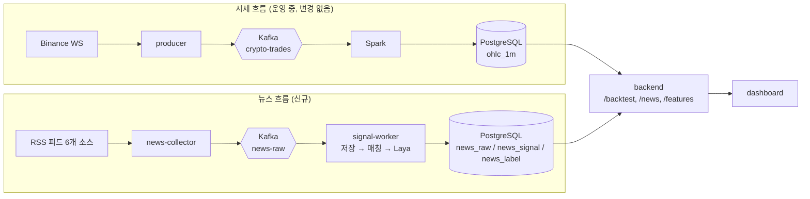

# kaspflow 뉴스·감정 시그널 파이프라인 설계서

- **문서 버전**: v0.3 (v0.2 + 구현·M0 실측 반영)
- **작성일**: 2026-10-16 · @정우혁
- **상태**: M0(맥 사전 검증)·M1·M2 코드(collector, 저장 전용 worker)·M3 코드(Laya 분류기)·M4(전략·API)·M5(대시보드) 구현 완료. **배포·라벨링·정확도 게이트(M2 실측, M3)는 아직**이고, 그 전의 백테스트 결과는 신호로 쓰지 않는다.

## 0. v0.1 → v0.2 변경 요약

| # | 변경 | 이유 |
| --- | --- | --- |
| 1 | 감쇠 기준 시각을 **봉 마감 시각 `T = t+Δ`** 로 통일 | 봉 안에서 수집된 기사의 지수가 양수가 되어 가중치가 1을 넘던 문제 |
| 2 | `news_score = Σws / (Σw + w0)`, 신호 유무는 감쇠 가중치 합 `Σw ≥ min_weight` 로 판정 | 기사 1건이 4시간 묵어도 점수 크기가 그대로이던 문제 |
| 3 | 조인 시 `published_at` 이 `collected_at` 보다 `max_age_min` 이상 오래된 기사는 제외 | 첫 기동 때 RSS가 주는 과거 기사 25~30건이 "방금 나온 뉴스"가 되는 누수 |
| 4 | 신호 만료 시 청산(`news_expired`), 체결 시점 규칙 명시 | 뉴스가 끊기면 `sell_th`에 영원히 못 닿아 무한 보유가 되던 문제 |
| 5 | 일 기사량 추정을 1,000건 → **수백 건 이하(M2에서 실측)** 로 내리고, 간격·파라미터 범위는 실측 뒤 확정 | 피드 보유량/갱신 주기상 1,000건은 과대. 거래 30회 게이트 도달 시점이 달라짐 |
| 6 | 리스크 서술을 "영어 코인 뉴스 + 종목 기준 감정 정확도"로 정정, `model_version` 예시 정정, 테이블 3개로 통일 | 소스·체크포인트는 영어인데 한국어 리스크/multilingual 예시가 남아 있었음 |
| 7 | 종목 매칭 규칙(단어 경계, 대소문자)과 `scope` 질문(MARKET 판정)을 스키마에 포함 | 짧은 티커 오탐, 스키마 밖 4번째 질문 |
| 8 | `event_type` 선택지를 영어 키로 정의, 전체 분포를 `p_event JSONB` 로 저장 | 질문은 영어인데 선택지는 한국어, top-1만 저장하면 보정·재분석 불가 |
| 9 | M2를 "저장 전용 signal-worker + collector"로 분리, `news-raw` 보존 기간 명시 | `news_raw` 쓰기 주체가 2.5GB 모델 서비스라서 M2 단독 배포가 불가능했음 |
| 10 | `news_signal.collected_at` 은 항상 `news_raw` 의 최초 값을 복사 | 재수집·재소비 때 시각이 밀리는 것 방지 |
| 11 | 수집기에 프로세스 내 중복 억제(seen set)·조건부 GET(ETag) 추가 | 5분마다 같은 25~30건을 매번 Kafka에 넣는 낭비 |

## 0-1. 구현·M0 실측에서 달라진 점 (v0.2 → v0.3)

| 항목 | 설계서(v0.2) | 실제 | 비고 |
| --- | --- | --- | --- |
| signal-worker 메모리 | 2.5GB | **기본 3g** (`SIGNAL_WORKER_MEM_LIMIT`) | 맥 CPU 실측: 모델 로드 순간 최대 **~2.8GB**, 상주 ~2.1GB. 2.5GB 상한이면 로드 중 OOM 위험. VM(Linux)에서 `docker stats` 로 다시 잴 것 |
| Laya 패키지 | 0.3.20 | **0.4.8** 로 검증·고정 | `model_version` = `laya-en@0.4.8/schema1` |
| 처리 시간 | 호출당 ~1초로 가정 | 맥 **중앙값 0.23s**(질문 3개 1회 호출), 첫 호출 0.26s, 최대 1.09s | VM 은 더 느리다고 보고 하한으로 읽는다. 로드 2s(가중치 캐시 후), 최초 다운로드 808MB |
| `MARKET` 판정 | 임계값 없음("맞으면") | `LAYA_MARKET_MIN_P` 기본 **0.9** | M0 헤드라인 20건에서 `scope` 질문이 시장 전체가 아닌 기사(개별 기업·토큰화 주식)에도 0.8 안팎을 줘 과발동. 라벨 정확도 측정 전까지 보수적으로 |
| 스키마 버전 | 환경변수 `SIGNAL_SCHEMA_VERSION` | 코드 상수 `questions.SCHEMA_VERSION` | 질문 문구와 버전이 어긋나지 않게 한 곳에 둔다. 환경변수는 쓰지 않는다 |
| `scope` 질문 | 별도 호출 | 종목 매칭이 없는 기사에서 `scope`+`sentiment`+`event_type` **한 번의 호출** | 호출 수 절감 |
| 전략 `confirm` | `none`/`combined` 문자열 | `confirm_combined` **0/1** | 파라미터 검증을 숫자로 통일 |
| news_signal 모델 버전 | — | API는 **가장 최근에 쓰인 model_version 하나만** 기본 사용 (`model_version` 쿼리로 고정 가능) | 버전이 섞여 기사 수가 부풀지 않게 |
| 대시보드 뉴스 | 마커 클릭 시 팝업 | 점(봉) 클릭 → 그 봉의 기사 목록(제목·링크) 패널 | `lightweight-charts` 마커에 링크를 직접 달 수 없어서 |

**로컬 E2E 확인(2026-10-17, 맥 Docker)**: RSS 8개 피드 전부 수집 성공(첫 폴링 204건: Cointelegraph 112, Decrypt 37, CoinDesk 25, The Block 20, Bitcoin Magazine 10) → `news-raw` → signal-worker(저장 전용) → `news_raw` 까지 실제 브로커로 동작. `INSTALL_LAYA=1` arm64 이미지 빌드 성공(1.64GB), 컨테이너 상주 메모리 **~2.2GB**. `--backfill` 로 204건 분류: 신호 127행(BTC 73, ETH 44, XRP 6, MARKET 4), 매칭 없음 91건. 기사량은 XRP가 예상대로 가장 적다. Laya 로드 시 경고 `this checkpoint ships invalid temperatures ... Treat confidence from the affected entries as uncalibrated` 가 나온다 → 온도 보정은 선택이 아니라 필수로 본다.

**VM 실측(2026-10-17, M3 분류 켬)**: 재부팅 후 `LAYA_ENABLED=true`, `SIGNAL_WORKER_MEM_LIMIT=3g`. 상주 메모리 **2.1~2.2GB / 3GB**, 호스트 available 약 4.5GB. 처리 속도는 **기사 224건 백필에 38.8분(모델 808MB 다운로드 포함), 기사당 약 10초** — 맥보다 약 10배 느리다(Spark 와 2 OCPU 공유, load avg 4 안팎). 하루 기사 수백 건이면 하루 1시간 안팎이라 실시간 처리는 되지만, 몰려 들어오면 lag 이 생길 수 있다. 첫 기동의 백필은 상주 worker 와 모델 2개가 동시에 뜨지 않게 `docker compose run --rm` 별도 컨테이너로 돌렸다. 주말에는 피드 8개 모두 1시간 가까이 새 기사가 없을 때가 있어 `/news/health` 의 30분 stale 기준은 오탐이 난다(M2 실측 뒤 조정).

**아직 검증하지 못한 것**: (1) 모델 카드의 ECE 0.081 이 **영어 체크포인트** 수치인지(카드의 비교표에서 어느 체크포인트인지 불분명), 영어 체크포인트가 영어 과제에서 다국어보다 정확하다는 주장. M3 에서 두 체크포인트를 같은 라벨로 비교해 확인한다.

**M0 관찰(헤드라인 20건, 정확도 평가가 아님)**: `event_type` 은 대부분 `other`, 감정은 중립 쪽으로 몰림, 관련도(relevance)는 0.3~0.7 대로 낮은 편. 영어 체크포인트의 선택지 설명은 질문당 ~192 토큰 예산을 나눠 쓰므로 설명을 짧게 유지한다(`questions.py`).

## 1. 개요

kaspflow의 시세 파이프라인 옆에 뉴스 수집 흐름을 하나 더 붙인다. 수집한 텍스트는 Laya로 종목별 관련도·감정·이벤트 유형 확률로 바꿔 저장하고, 이 값을 백테스트 전략의 입력 피처로 쓴다. **매매 판단 자체는 Laya가 하지 않는다.**

- **범위**: 뉴스 수집, 종목 매칭, Laya 분류, 시그널 저장, 백테스트 전략 1종 추가, 대시보드 마커.
- **범위 밖**: 실거래 주문, LLM 기반 매매 판단, 과거 뉴스 백필.
- **전제**: 과거 데이터 정합성은 다루지 않는다. 기동 시점부터 쌓이는 데이터만으로 검증한다.
- **대상 자산**: Binance 코인 `BTCUSDT`, `ETHUSDT`, `XRPUSDT`(`SYMBOLS`). 백테스트 봉 간격은 5~30분에서 시작(M2 실측 후 확정). 개발은 Apple Silicon 맥.
- 이 설계는 시스템 구조에 대한 것이며 투자 조언이 아니다.

## 2. 현재 자산

새로 만들 것은 뉴스 수집기, signal-worker, 테이블 3개, 전략 1개다.

| 구성 요소 | 현재 상태 | 이번 작업에서의 역할 |
| --- | --- | --- |
| Kafka (KRaft, 단일 브로커) | `crypto-trades`, mem_limit 1500m | 토픽 `news-raw` 추가 |
| Producer (`producer/main.py`) | Binance WS → Kafka, 지수 백오프 | 뉴스 수집기의 구조 템플릿 |
| Spark (`ohlc_stream.py`) | 1분봉 집계 → upsert, 2GB | 변경 없음 |
| PostgreSQL 17 (VM 네이티브) | `crypto` DB, `ohlc_1m`, `price_alert` | 뉴스 테이블 3개 추가 |
| Backend (`app.py`, `backtest.py`) | `/ohlc`, `/backtest`, 전략 6종, 순수 함수 엔진 | 뉴스 조회 API, 전략 추가 |
| Dashboard (React + lightweight-charts) | 캔들, 백테스트 패널, 마커 | 뉴스 마커, 감정 패널 |
| CI/CD | GHCR 멀티아치, VM 2분 폴링 배포·헬스체크·롤백 | 이미지 2개를 matrix에 추가 |

### 배포 대상 VM (oracle_vm 2026-10-04 실측 기준)

- OCI VM.Standard.A1.Flex(arm64), 2 OCPU, 12GB RAM, 디스크 194GB(16% 사용), 시간대 Asia/Seoul.
- 함께 도는 서비스: midas-touch(systemd), PostgreSQL 17 + pgvector, Caddy, supermemory, openclaw-gateway, life-log-daemon. kaspflow는 컨테이너 6개. Neo4j는 꺼져 있음.
- backend 호스트 포트는 `.env`의 `BACKEND_HOST_PORT=8010`(8000은 midas-touch). Caddy가 `/api/*`를 backend로 넘기므로 새 API도 `/api` 아래에 두고 Caddy 설정은 바꾸지 않는다.
- 원칙: compose 파일을 고치지 않고 `.env` 로 설정을 바꾼다(자동배포 롤백 `git reset --hard` 가 파일 수정을 지움).
- oracle_vm `docs/07-issues.md`에 재부팅 필요 플래그가 있다. 메모리를 많이 쓰는 signal-worker(M3)를 올리기 전에 재부팅한다.

## 3. 목표 아키텍처



## 4. 컴포넌트 설계

### 4.1 news-collector

- **수집 경로**: 해외 코인 전문 매체 공식 RSS만 사용. 제목과 짧은 요약만 받고 본문 스크래핑은 하지 않는다. API 키 불필요.
- **주기**: 피드별 5분 폴링(`NEWS_POLL_SECONDS`). 피드 목록은 `.env`(`NEWS_FEEDS`)로 바꾼다.
- **조건부 GET**: 피드마다 `ETag`/`Last-Modified` 를 저장해 `If-None-Match`/`If-Modified-Since` 로 요청한다. 304면 파싱도 produce도 하지 않는다.
- **정규화**: 모든 소스를 같은 메시지 스키마로 맞추고 시각은 UTC. HTML 태그 제거 후 본문은 2,000자로 자른다.
- **중복 억제**: 프로세스 안의 `seen` 집합(최대 20,000개, 오래된 것부터 제거)에 있는 `article_id` 는 다시 produce하지 않는다. 재시작하면 한 번 더 나갈 수 있고, **최종 중복 판정은 consumer(`news_raw` PK)** 가 한다. 즉 수집기는 영속 상태를 갖지 않는다.
- **produce**: 파티션 키 `source`. 기존 producer와 같은 설정(`acks=all`, idempotence, lz4).
- **토픽 보장**: 기동 시 `news-raw` 가 없으면 `retention.ms=14일`로 생성한다(있으면 그대로 둔다). worker가 늦게 배포되어도 14일치가 버퍼가 된다.
- **재시도**: 소스별로 독립 루프. 실패하면 1→2→4…초, 상한 `MAX_BACKOFF=300`초(기존 producer는 30초지만 폴링 서비스라 더 길게). 한 소스의 실패가 다른 소스를 막지 않는다.
- **제외**: Blockworks(2026-01 이후 새 기사 없음), CryptoSlate(연속 요청 제한; 나중에 15분 주기로만 검토).

**수집 소스** (2026-10-05 동작 확인, Feeder 기준):

| 소스 | 피드 URL | 비고 |
| --- | --- | --- |
| coindesk | `https://www.coindesk.com/arc/outboundfeeds/rss/?outputType=xml` | 최근 25건. 예전 `/feed/` 는 2024년 중단. **요약·본문이 비어 있음(2026-10-16 실측) — 제목만으로 분류** |
| cointelegraph | `https://cointelegraph.com/rss` | 최근 30건. 기사량 최다 |
| cointelegraph | `https://cointelegraph.com/rss/tag/bitcoin`, `/ethereum`, `/altcoins` | 각 30건. **커버리지 보강용**이며 매칭은 별칭 사전만 쓴다(피드 태그를 힌트로 쓰지 않는다 — 메인 피드와 겹치면 먼저 본 피드의 기사만 나가므로 힌트가 일관되지 않다) |
| theblock | `https://www.theblock.co/rss.xml` | 약 20건 |
| decrypt | `https://decrypt.co/feed` | 요약 포함 |
| bitcoinmagazine | `https://bitcoinmagazine.com/feed` | 최근 10건 |

같은 사이트의 여러 피드는 같은 `source` 이름을 쓰고, URL 정규화 해시로 중복이 걸러진다.

**`news-raw` 메시지 스키마**:

| 필드 | 타입 | 설명 |
| --- | --- | --- |
| `article_id` | text | 정규화한 URL의 SHA-256(hex). 중복 판정 키 |
| `source` | text | 소스 이름 |
| `url` | text | 원문 링크(정규화 전 원본) |
| `title` | text | 제목 |
| `body` | text | 요약(HTML 제거, 2,000자 이내) |
| `lang` | text | 피드 설정값(기본 `en`). 모르면 빈 문자열 |
| `published_at` | text(ISO8601 Z) \| null | 기사 발행 시각(UTC). 없으면 `null` |
| `collected_at` | text(ISO8601 Z) | 수집기가 이 기사를 **처음** 받은 시각(UTC). 백테스트 기준 시각 |

URL 정규화: 스킴·호스트 소문자화, `#fragment` 제거, `utm_*`·`fbclid`·`gclid`·`ref` 등 추적 파라미터 제거, 나머지 쿼리는 키 정렬, 경로 끝 `/` 제거.

### 4.2 signal-worker

메시지 1건당 처리 순서. DB 기록이 끝난 뒤에 오프셋을 커밋한다(`enable.auto.commit=false`). 재시작으로 같은 메시지가 다시 와도 upsert라서 결과가 같다.

1. `news_raw` 에 `ON CONFLICT DO NOTHING` 으로 넣는다. 이미 있던 기사면 여기서 끝낸다. 이후 단계가 쓰는 `collected_at` 은 **메시지 값이 아니라 `news_raw` 에 저장된 값**이다(재수집으로 시각이 밀리지 않게).
2. **종목 매칭**: `symbols.yaml` 별칭 사전으로 제목+본문을 검색한다.
   - 단어 경계: `(?<![A-Za-z0-9])별칭(?![A-Za-z0-9])`.
   - 티커처럼 짧은 대문자 별칭(`BTC`, `ETH`, `XRP`)은 **대소문자 구분**, 이름(`Bitcoin`, `Ethereum`, `Ripple`)은 구분하지 않는다.
   - 예: `BTCUSDT: [BTC, Bitcoin]`, `ETHUSDT: [ETH, Ethereum, Ether]`, `XRPUSDT: [XRP, Ripple]`. 한국어 별칭은 소스가 전부 영어이므로 지금은 넣지 않는다.
   - 매칭이 없으면 `scope` 질문을 한 번 묻고, 시장 전체 기사면 가상 심볼 `MARKET` 으로 저장한다.
3. **Laya 분류**: 매칭된 종목마다 아래 질문 3개를 한 번의 호출로 묻는다.
4. `news_signal` 에 기사×종목×모델 버전 단위로 upsert한다.

**질문 스키마 (`schema_version = 1`)** — 모두 `choice` 유형. 예·아니오(`noul`)와 등급(`score`)은 모델 카드가 약점으로 밝히고 있어 쓰지 않는다.

| 키 | 선택지 (키 → 의미) | 용도 |
| --- | --- | --- |
| `relevance` | A: mainly about it / B: only mentions it / C: not about it | 이름만 스친 기사 거르기 |
| `sentiment` | A: positive / B: neutral / C: negative (대상 코인 기준) | 감정 |
| `event_type` | A: listing_delisting / B: regulation_legal / C: hack_security / D: institutional_etf_flow / E: partnership_tech / F: macro / G: other | 이벤트 유형 (선택지 8개 이하) |
| `scope` (미매칭 기사에만) | A: about the crypto market as a whole / B: about something else | `MARKET` 판정 |

- 선택지 키는 A/B/C…, 설명은 영어. 대시보드 표시용 한국어 라벨은 UI에서만 매핑한다.
- `MARKET` 의 `sentiment` 는 대상을 "the overall crypto market"으로 묻는다.
- 체크포인트: 소스가 영어뿐이라 **영어 체크포인트**(ModernBERT-large)를 쓴다. 입력은 제목+요약이라 512토큰 안이다.
- 질문 문구를 바꾸면 `schema_version` 을 올린다. 이전 버전 결과는 지우지 않는다.
- `model_version` 형식: `laya-en@<laya 패키지 버전>/schema<N>` (예: `laya-en@0.4.8/schema1`).

**국내 주식으로 넓힐 때**: OpenDART 공시 수집기를 news-collector와 같은 형태로 하나 더 둔다. 공시는 종목코드가 붙어 오므로 2단계 매칭을 건너뛴다. 시세 쪽은 주식 시세 producer가 필요하다.

## 5. 데이터 모델 (`db/news.sql`)

원문(`news_raw`)과 모델 결과(`news_signal`)를 나눠서, 모델이나 질문을 바꿔도 원문은 그대로 두고 신호만 다시 계산한다. 전체 DDL은 [`db/news.sql`](../db/news.sql).

| 테이블 | 키 | 비고 |
| --- | --- | --- |
| `news_raw` | `article_id` | 원문. `published_at` NULL 허용, `collected_at` NOT NULL |
| `news_signal` | `(article_id, symbol, model_version)` | `p_relevant`, `p_pos/neu/neg`, `event_type`(top-1), **`p_event JSONB`**(전체 분포), `collected_at`(= `news_raw` 값 복사) |
| `news_label` | `(article_id, symbol, field)` | 사람이 붙인 정답. 정확도 측정·파인튜닝용 |

- 백테스트 기준 시각은 `published_at` 이 아니라 **`collected_at`** (시스템이 그 기사를 실제로 안 시각).
- VM에서는 컨테이너 PG가 아니라 자동 실행되지 않으므로 한 번 적용한다: `sudo -u postgres psql -d crypto -f db/news.sql`. **backend/collector 배포 전에** 적용한다.
- 용량: 기사 1건 본문 포함 약 5KB. 하루 수백 건이면 연 1GB 안팎, 1,000건이어도 2GB 안팎이라 디스크 여유(약 181GB)로 충분하다.
- 서버 시간대가 KST여도 DB와 Kafka의 시각은 모두 UTC. 표시할 때만 KST로 바꾼다.

## 6. 백엔드·백테스트·대시보드 확장

`backtest.py` 의 순수 함수 구조는 그대로 두고, 봉 DataFrame에 뉴스 피처 열을 붙인 뒤 새 전략 `news_sentiment` 를 기존 6종 옆에 등록한다.

### 6.1 선행 작업 (M1, 구현됨)

- **다음 봉 시가 체결** `fill="next_open"`: 신호는 봉 `i` 의 종가에서 확정하고, 체결은 봉 `i+1` 의 시가에서 한다.
  - 손절·익절·추격손절 **판정**은 기존과 같이 봉 `i` 종가 기준이고, **체결**만 다음 봉 시가다.
  - 마지막 봉에서 확정된 주문은 다음 봉이 없어 체결되지 않는다(경고 문구로 알림).
  - 거래 `entry_time`/`exit_time` 과 마커 시각은 **체결된 봉**의 시각이다.
  - 기본값은 기존과 같은 `close`(기존 전략·테스트 동작 불변). 뉴스 전략의 권장값은 `next_open`.
- **봉 간격 30m**: `INTERVALS`/`INTERVAL_MINUTES`/`candles.ts` 에 추가. 대시보드 버튼은 `/intervals` 로 받으므로 자동 반영.

### 6.2 뉴스 피처 조인 규칙

봉 `[t, t+Δ)` 의 기준 시각을 **봉 마감 `T = t+Δ`** 로 둔다.

- 대상 신호: `collected_at < T`, `p_relevant ≥ rel_th`(기본 0.5), `published_at` 이 있고 `collected_at − published_at ≤ max_age_min`(기본 360분). `published_at` 이 NULL이면 보수적으로 제외한다.
- 기사 1건의 점수: `s = p_pos − p_neg` (−1~1).
- 가중치: `w = p_relevant · exp(−(T − collected_at) / τ)`. `collected_at < T` 이므로 지수는 항상 0 이하다.
- 봉별 피처:

```
news_weight = Σ w                       # 감쇠 가중치 합 (신호 신선도)
news_score  = Σ (w · s) / (Σ w + w0)    # w0: 사전 가중치(기본 0.5). 기사가 적거나 오래되면 0쪽으로 수축
news_count  = lookback_min 안 기사 수 (감쇠 전, 참고용)
event_*     = 이벤트 유형별 개수
```

- `MARKET` 신호는 모든 심볼에 `market_w` 배로 가중해 더한다(`w ← market_w · w`).
- 단순 가중평균이 아니라 **수축 평균**을 쓰는 이유: 단순 가중평균은 기사가 1건이면 몇 시간 묵어도 점수 크기가 그대로이다. 수축 평균은 기사가 적거나 오래되면 점수가 0으로 약해진다.

### 6.3 새 전략 `news_sentiment`

| 파라미터 | 기본값 | 의미 |
| --- | --- | --- |
| `lookback_min` | 240 | 피처 계산 창(분) |
| `tau_min` | 120 | 감쇠 시간 상수(분) |
| `buy_th` | 0.3 | `news_score` 가 이 값 이상이면 진입 |
| `sell_th` | −0.2 | 이 값 이하이면 청산 |
| `min_weight` | 1.0 | `news_weight` 가 이 값 미만이면 "신호 없음" (기사 수 대신 감쇠 가중치로 판정) |
| `max_age_min` | 360 | 발행 후 이 시간이 지난 기사는 제외 |
| `rel_th` | 0.5 | 관련도 하한 |
| `w0` | 0.5 | 사전 가중치 |
| `confirm_combined` | 0 | 1 이면 기존 복합 전략 스탠스가 약세가 아닐 때만 진입 |
| `market_w` | 0.5 | `MARKET` 신호 반영 비율 |

신호 규칙(봉 마감 시점, 체결은 `next_open`):

1. 미보유: `news_weight ≥ min_weight` 이고 `news_score ≥ buy_th` 이면 진입.
2. 보유: `news_weight ≥ min_weight` 이고 `news_score ≤ sell_th` 이면 청산(`signal`).
3. 보유: `news_weight < min_weight` 이면 신호가 식은 것으로 보고 청산(`news_expired`). **뉴스가 끊겨도 무한 보유하지 않는다.**
4. 손절·익절·추격손절은 기존 리스크 오버레이를 그대로 쓴다.

기본값은 출발점일 뿐이다. 데이터가 쌓인 뒤 그리드 서치로 고르되, 고른 구간과 검증 구간을 시간 순서로 나눈다. **기사량이 적으면(5절의 실측 참고) 15m·4시간 창에서는 거래가 거의 안 생길 수 있으므로**, M2 실측 뒤 `lookback_min`·`tau_min`·봉 간격을 다시 정한다.

### 6.4 API

| 메서드 | 경로 | 내용 |
| --- | --- | --- |
| GET | `/news?symbol=&limit=` | 최근 신호와 제목·링크·확률 |
| GET | `/news/health` | 마지막 `collected_at` 과 경과 시간 (수집 중단 감지) |
| GET | `/features?symbol=&interval=` | 봉별 기술 지표 + 뉴스 피처 (오프라인 ML 내보내기) |
| GET | `/backtest?strategy=news_sentiment` | 기존 엔드포인트. 이 전략일 때만 뉴스를 조회. `fill` 쿼리 추가(M1 구현됨) |

- `run_backtest()` 에는 선택 인자 `news: list[dict] | None` 만 추가한다. 기존 전략·테스트는 바뀌지 않는다.
- 뉴스 테이블이 없거나 비어 있어도 기존 전략과 `/health` 는 영향받지 않는다(뉴스 조회는 `news_sentiment` 요청 때만).
- 테스트: `tests/test_backtest.py` 에 합성 뉴스로 조인 경계(봉 마감 직전·직후 기사), 오래된 기사 제외, 신호 만료 청산을 검증한다.

### 6.5 대시보드

- 캔들 차트에 뉴스 마커를 감정 색으로 찍고, 누르면 제목과 링크를 보여 준다.
- 차트 아래에 `news_score` 보조 선.
- `news_sentiment` 는 `/backtest/strategies` 로 목록에 자동 반영.
- 백테스트 결과에 같은 기간 `combined` 전략과 보유 전략 성과를 나란히 보여 준다(기준선).

## 7. 배포·운영

새 서비스 2개를 기존과 같은 방식으로 붙인다(GHCR 멀티아치, `docker-compose.prod.yml`, `.env`, VM 폴링 자동배포).

### 메모리 예산

| 서비스 | mem_limit | 비고 |
| --- | --- | --- |
| 기존 스택 (kafka 1500m, kafka-ui 400m, producer 300m, spark 2g, backend 400m, dashboard 200m) | 약 4.8GB 상한 | 실사용 약 3~3.5GB (코드 기준 합계 확인) |
| news-collector | 200m | 순수 파이썬 HTTP 폴링 |
| signal-worker (M2, 저장 전용) | 300m | 모델 없음 |
| signal-worker (M3~, Laya) | **3GB** (맥 실측: 로드 최대 ~2.8GB, 상주 ~2.1GB) | 영어 체크포인트 1개 + PyTorch CPU. 첫 배포 때 `docker stats` 실측 후 조정 |
| 합계 상한 (M3 이후) | 약 8GB | 가용 8.5GB(kaspflow 배포 전 2026-09-25 값) 안이지만 **여유가 0.5GB뿐**이다. 다른 서비스가 늘었다면 넘칠 수 있어 M3 전에 반드시 재측정 |

- 지금은 midas-touch, supermemory, openclaw-gateway, life-log-daemon이 함께 돌아 여유가 더 적을 수 있다. **M3 전에 oracle_vm `collect.sh` 로 메모리를 다시 재고** signal-worker 상한을 그 값에 맞춘다.
- 여유가 3GB에 못 미치면 `laya[onnx]`(ONNX Runtime)로 메모리를 줄이는 방안을 먼저 실측한다.
- PG는 호스트에서 돌기 때문에 컨테이너 상한이 PG를 보호한다. 상한은 반드시 건다.

### signal-worker 이미지 (M3)

- M2는 **모델 의존성 없는 저장 전용** 이미지(`LAYA_ENABLED=false`). M3에서 CPU 전용 arm64 PyTorch wheel을 포함한 빌드로 바꾼다. CUDA 패키지가 들어가면 이미지가 수 GB로 커진다.
- 모델 가중치는 이미지에 넣지 않고 Hugging Face 캐시를 named volume(`hf-cache`)에 둔다.
- `torch.set_num_threads(2)`. Spark와 CPU를 나눠 쓰므로 처리량은 실측.
- QEMU arm64 빌드에서 PyTorch 설치가 느리면 GitHub arm64 러너로 해당 이미지만 따로 빌드한다.

### 처리량 추정

Laya 모델 카드는 CPU 호출당 약 193~464ms를 제시한다(이 문서는 모델 카드를 직접 검증하지 않았다 — M0에서 맥으로 확인). arm64 2 OCPU에서는 더 느릴 수 있으니 호출당 1초로 잡는다. 하루 기사 N건 × 종목 1.5개면 호출 1.5N회다. N=1,000이어도 약 25분 분량이라 실시간 처리에 여유가 있다. **N은 M2에서 실측한다**(피드 보유량과 갱신 주기상 수백 건 이하로 추정).

### CI/CD 변경

- `publish-images.yml` matrix 에 `news-collector` 추가(M2). `signal-worker` 는 디렉터리가 생기는 시점에 추가.
- `ci-backend.yml` paths 필터와 테스트 스텝에 `news-collector/**` 추가.
- `.env.prod.example` 에 `NEWS_FEEDS`, `NEWS_POLL_SECONDS`, `NEWS_TOPIC` 추가(M3: `LAYA_ENABLED`, `SIGNAL_WORKER_MEM_LIMIT`, `LAYA_CHECKPOINT`, `LAYA_THREADS`, `LAYA_MARKET_MIN_P`). 키가 필요한 소스를 더하면 키는 VM `.env` 에만 둔다.

### 모니터링

- 수집 중단: `/news/health` 경과 시간이 30분을 넘으면 이상.
- 처리 지연: Kafka UI에서 `news-raw` consumer lag.
- 모델 품질: `news_label` 이 쌓일 때마다 질문별 정확도 재계산.
- 자동배포 헬스체크는 지금처럼 backend `/health` 만 본다. 뉴스 서비스가 죽어도 시세 대시보드가 롤백되지 않게 하기 위해서다.

### 서버 문서 갱신 (oracle_vm 저장소 규칙)

1. VM에서 `./scripts/collect.sh` 를 다시 돌려 `snapshots/` 갱신.
2. `docs/02-services.md` 에 컨테이너(news-collector, signal-worker)와 메모리 상한 기록.
3. `docs/04-databases.md` 에 crypto DB 테이블 3개와 Kafka 토픽 `news-raw` 기록.
4. 키가 필요한 소스를 더하면 키는 kaspflow `.env` 에만 두고 oracle_vm에는 위치만 적는다.

## 8. 단계별 개발 계획

각 단계는 게이트를 통과해야 다음으로 넘어간다. **M2에서 원문 수집부터 먼저 배포**하는 이유: 과거 데이터 없이 앞으로 쌓이는 데이터만 쓰므로 하루라도 일찍 켜야 라벨링·백테스트용 원문이 쌓인다.

| 단계 | 내용 | 게이트 |
| --- | --- | --- |
| M0 | 맥에서 Laya 사전 검증: 영어 코인 기사 제목 20건으로 설치·메모리·처리 시간·결과 확인 (VM은 더 느리므로 시간은 하한) | 설치·추론 성공, 호출당 시간 기록 |
| M1 | 선행 작업: `fill=next_open`, 30m, `db/news.sql` **(구현됨)** | 단위 테스트 통과 |
| M2 | `news-collector` + 저장 전용 `signal-worker` 배포. `news.sql` 을 VM에 먼저 적용 | 24~48h 실측: 일 기사 수, 소스별·종목별 매칭 수, 중복률. 이 수치로 봉 간격·`lookback_min`·라벨 표본 가능성 재확정 |
| M3 | Laya 분류 + 라벨링 + 정확도 측정. 메모리 재측정·재부팅 선행 | 아래 정확도 기준 |
| M4 | `news_sentiment` 전략, 뉴스 API, 조인 경계 테스트 | 거래 30회 이상, `combined`·보유와 비교 |
| M5 | 대시보드 마커·보조 선·기준선 비교 | — |

### M3 정확도 기준

relevance와 sentiment가 모두 기준을 넘어야 M4로 간다. event_type은 기준 미달이어도 진행하되 그 피처만 전략에서 뺀다.

| 질문 | 통과 기준 | 근거 |
| --- | --- | --- |
| relevance | 정확도 0.80 이상 | 1차 필터라 가장 높게 |
| sentiment | 정확도 0.70 이상, 그리고 최빈 클래스 기준선보다 0.10 이상 높음 | 중립이 많아 "전부 중립"만 찍어도 높게 나옴 |
| event_type | 정확도 0.65 이상 | 선택지 7개라 낮게 |
| 보정 | 온도 보정 후 ECE 0.10 이하 | 모델 카드의 ECE 0.081(어느 체크포인트 수치인지 불분명, 미검증) |

- 표본: 기사×종목 150쌍을 소스별로 고르게 뽑아 직접 라벨. 오차 대략 ±7%p라 기준선 근처 결과는 50쌍을 더 붙여 다시 잰다. **M2 실측 기사량으로 150쌍을 채우는 데 걸리는 기간을 먼저 확인한다**(XRP는 적을 수 있음).
- 미달 시 순서: 질문 문구 수정 → 온도 보정 → 라벨 300쌍 이상으로 파인튜닝.
- 도구: `signal-worker/label.py` (컨테이너 안에서 실행).
  - `python label.py label [--n 150]` — 라벨 없는 기사×종목 쌍을 소스별 라운드로빈으로 뽑아 relevance·sentiment·event_type 을 입력받아 `news_label` 에 넣는다. 모델 예측은 보여 주지 않는다(앵커링 방지).
  - `python label.py eval` — 질문별 정확도(±95% 구간), 최빈 클래스 기준선, ECE(보정 전/후)와 게이트 판정. 종료 코드 0이면 M4 진행 가능.
  - relevance 는 `news_signal` 에 `p_relevant`(주 대상 확률)만 있으므로 "주 대상인가" 이진 정확도로 잰다. 전략 필터(`p_relevant ≥ 0.5`)와 같은 기준이다.
  - 온도 T 는 `collected_at` 순 앞 절반에서 맞추고 뒤 절반에서 ECE 를 잰다(같은 표본으로 맞추고 재면 낙관적).

#### 임시 측정: LLM 대리 라벨 (2026-10-17)

사람 라벨 대신 Claude 가 150쌍(BTC 81, ETH 48, XRP 17, MARKET 4)에 라벨을 붙여 먼저 재 봤다. 라벨 파일은 `signal-worker/eval/claude_labels_20261017.csv`, 실행은 `python label.py eval --labels eval/claude_labels_20261017.csv`. **사람 라벨이 아니므로 게이트 판정으로 쓰지 않고 방향만 본다.** `news_label` 에는 넣지 않았다.

| 질문 | 정확도 | 기준선(최빈) | ECE 보정 후 | 관찰 |
| --- | --- | --- | --- | --- |
| relevance | 0.567 | 0.587 | 0.090 | **기준선보다 낮다.** AUC 0.62, 임계값을 바꿔도 최고 0.613(@0.65). 무관 기사에 평균 0.90을 주는 등 거의 구분 못 함 |
| sentiment | 0.667 | 0.380 | 0.138 | 기준 0.70에 근접, 기준선보다 +0.29. 긍정↔부정 뒤집힘은 2건뿐이고 오류 대부분이 중립 경계 → `p_pos − p_neg` 의 방향은 쓸 만해 보임 |
| event_type | 0.400 | 0.347 | 0.132 | 기관·ETF 기사를 `other` 로 보내는 경우가 가장 많음(17건) |

결론(잠정): relevance 필터(`p_relevant ≥ 0.5`)는 지금 사실상 무작위라 전략에서 빼거나 질문 문구를 고쳐야 한다(설계상 미달 시 첫 단계). sentiment 는 문구 수정 없이도 기준선에 가깝다. event_type 은 전략에서 뺀다.

### 개발 환경

- Apple Silicon 맥은 VM과 같은 arm64다. signal-worker 이미지를 CI 전에 맥에서 먼저 확인한다.
- 로컬 전체 스택(Kafka, Spark, worker)은 Docker Desktop 메모리 할당을 늘려야 할 수 있다.

## 9. 리스크와 검증 방법

가장 큰 리스크는 **영어 코인 뉴스에서 Laya의 종목 기준 감정 분류가 얼마나 정확한지 아직 모른다**는 점이다. M3 게이트에서 직접 측정하기 전까지는 신호를 전략에 쓰지 않는다.

| 리스크 | 영향 | 대응 |
| --- | --- | --- |
| 영어 코인 뉴스·종목 기준 감정 정확도 미확인 | 신호가 노이즈 | 150쌍 라벨로 질문별 정확도 측정. 미달이면 문구 수정 → 온도 보정 → 파인튜닝 |
| 확률 과신 | 확률을 신뢰도로 오해 | 자체 라벨로 온도 보정 후 사용 |
| 기사량 부족 | 거래가 안 생기거나 결론이 우연 | M2 실측으로 간격·창 재확정. 거래 30회 미만이면 판단 보류. 항상 `combined`·보유와 함께 비교 |
| 시간 누수 | 성과 과대평가 | `collected_at` 기준, 봉 마감 기준 감쇠, 오래된 기사 제외, `next_open` 체결, 경계 단위 테스트 |
| 첫 기동 때 과거 기사 | 묵은 기사가 신선한 신호로 | `max_age_min` 필터, `published_at` NULL 제외 |
| 중복 기사 | 기사 수·점수 부풀림 | URL 해시 중복 제거. 필요하면 제목 유사도 중복 제거 |
| 모델·질문 교체 | 과거 신호와 비교 불가 | `model_version` 을 키에 포함, 덮어쓰지 않음 |
| 종목 매칭 오탐 | 엉뚱한 종목에 신호 | 단어 경계·대소문자 규칙, relevance 필터 |
| VM 메모리 부족 | 호스트 PG까지 영향 | `mem_limit`, 체크포인트 1개, M3 전 재측정 |
| 수집 약관 | 서비스 차단·법적 문제 | 공식 RSS만, 조건부 GET, 폴링 5분 |

성과 판단의 기준선은 같은 기간·같은 비용 조건의 `combined` 전략과 단순 보유다. 뉴스 전략이 이 둘을 일관되게 넘지 못하면 뉴스 피처는 효과가 없는 것으로 본다.

## 10. 출처

- Crypto news RSS feeds (Feeder, 2026-10-05 확인)
- convaiinnovations/laya 모델 카드 (이 문서 작성 시 직접 검증하지 않음 — M0에서 확인)
- kaspflow 저장소 README, `docs/deploy-notes.md`, `infra/vm-setup.md`
- oracle_vm 저장소 README (2026-10-04 실측)
